


 

<a href="https://www.linkedin.com/in/diegonatalo/">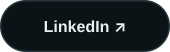</a>
<a href="mailto:diegonatalo@gmail.com">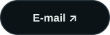</a>

 

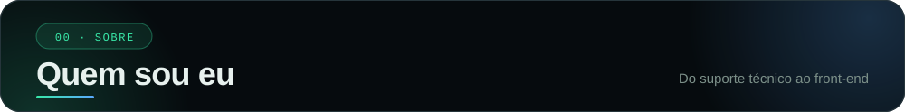

 

Vim do suporte técnico de um provedor de internet, onde cheguei ao N2. Foi lá que aprendi onde o usuário trava e o que uma ferramenta precisa ter para a equipe realmente usar.

Hoje levo essa bagagem para o front-end: construo interfaces modernas, acessíveis e performáticas, com foco em experiência do usuário. Meu objetivo é atuar profissionalmente como desenvolvedor.

Fora do código, eu treino, leio e gosto de entender como as coisas funcionam, inclusive eu mesmo. Nada é perfeito, mas pizza chega bem perto. 🍕

 

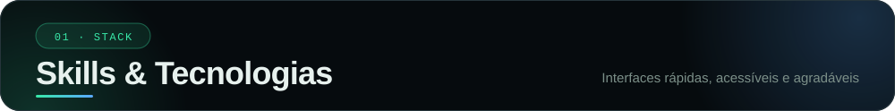

 

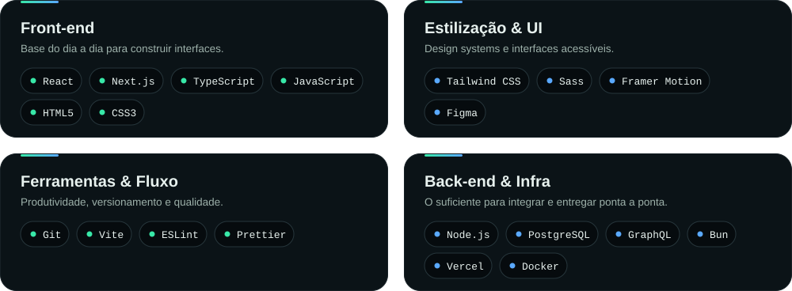

 

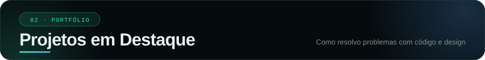

 

<a href="https://triagem-web.vercel.app">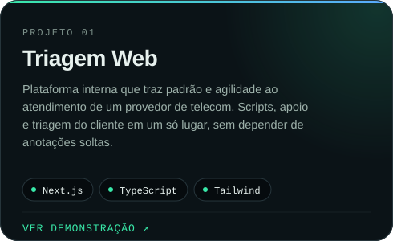</a>
<a href="https://github.com/diegonatalo/entendendo-algoritmos">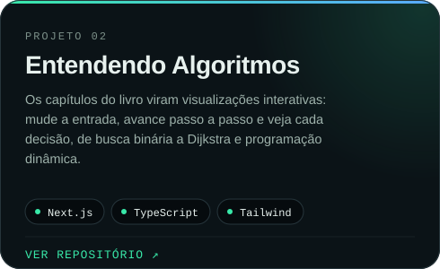</a>

 
<a href="https://fiinance1.vercel.app">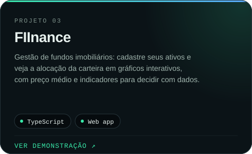</a>
<a href="https://dn-fitlog.vercel.app">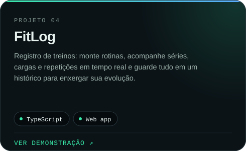</a>

   
  <a href="https://diegonatalo.dev"><b>Ver todos os projetos no portfólio →</b></a>

 

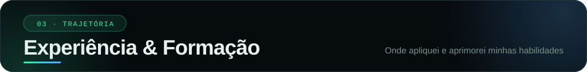

 

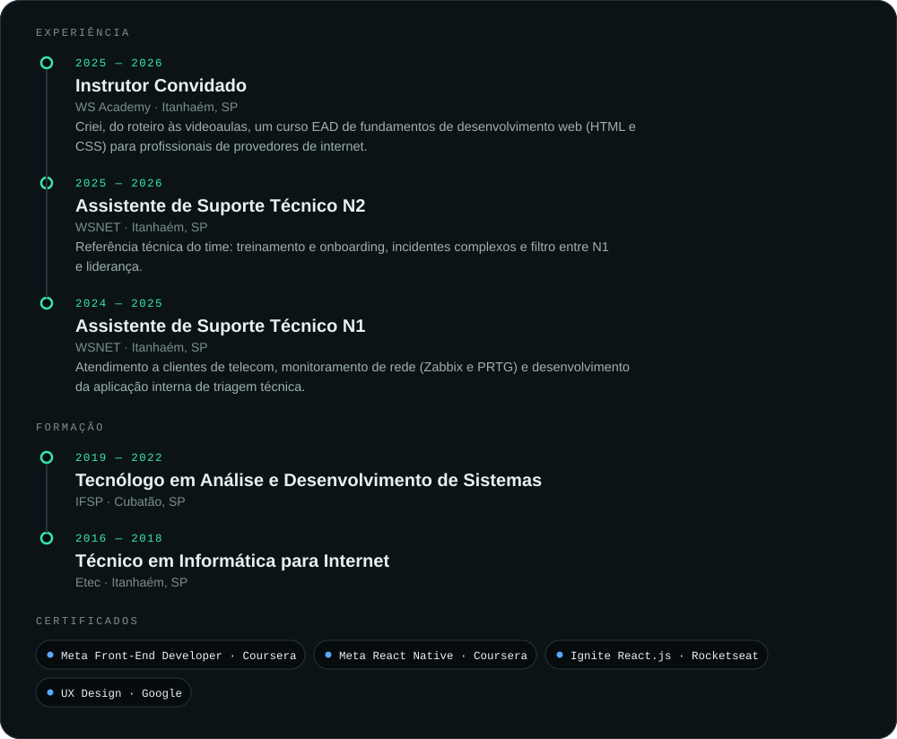

 

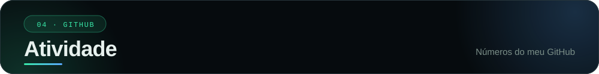

 

 

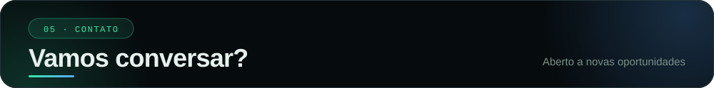

 

Tem um projeto em mente? Estou aberto a novas oportunidades e parcerias.

 

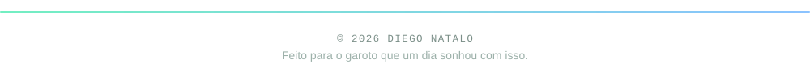

