<!--
  Imagens geradas por generator/ (pnpm generate): edite generator/content.mjs e gere de novo.
  As imagens trocam de tema com <picture>. Dentro de um link o GitHub desmonta o <picture>,
  então os botões têm uma versão só e os cards de projeto ficam sem link (as demos vêm em texto).
-->

<picture><source media="(prefers-color-scheme: dark)" srcset="assets/banner-dark.png">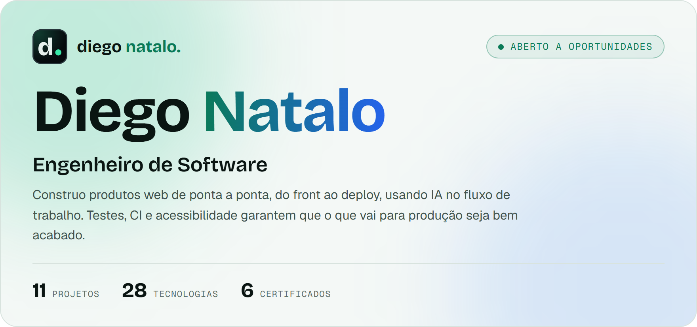</picture>

 

<a href="https://www.linkedin.com/in/diegonatalo/">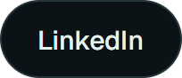</a>
<a href="mailto:diegonatalo@gmail.com">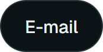</a>
<a href="https://diegonatalo.dev/diego-natalo-cv.pdf">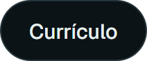</a>

 

<picture><source media="(prefers-color-scheme: dark)" srcset="assets/h-sobre-dark.png">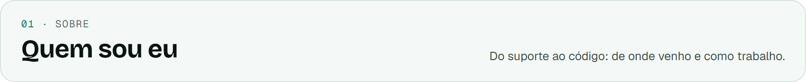</picture>

 

Vim do suporte técnico de um provedor de internet, onde cheguei ao N2. Lá aprendi onde o usuário trava e o que uma ferramenta precisa ter para a equipe usar de verdade. Foi assim que nasceu a Triagem Web, meu primeiro sistema usado no dia a dia.

Hoje construo produtos web de ponta a ponta, do front ao deploy, com **Next.js**, **TypeScript** e **Postgres**, e uso IA no fluxo de trabalho. Testes, CI e acessibilidade fazem parte de todo projeto, não ficam para depois.

Fora do código, eu treino, leio e gosto de entender como as coisas funcionam, inclusive eu mesmo. Nada é perfeito, mas pizza chega bem perto. 🍕

 

<picture><source media="(prefers-color-scheme: dark)" srcset="assets/h-stack-dark.png">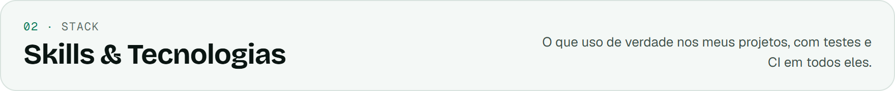</picture>

 

<picture><source media="(prefers-color-scheme: dark)" srcset="assets/stack-dark.png">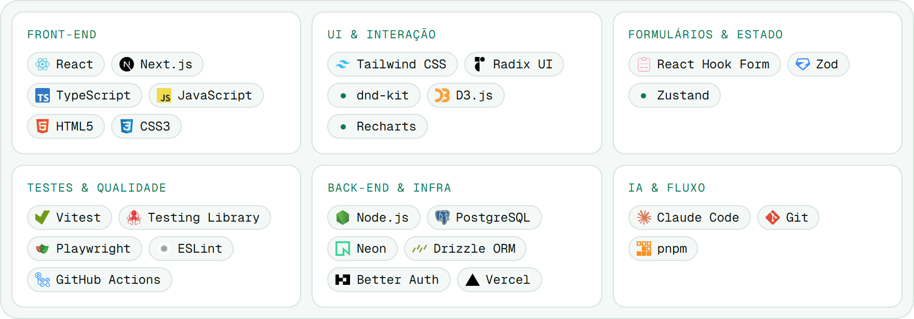</picture>

 

<picture><source media="(prefers-color-scheme: dark)" srcset="assets/h-projetos-dark.png">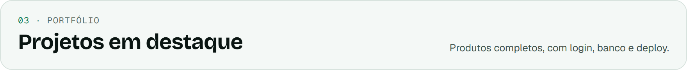</picture>

 

<picture><source media="(prefers-color-scheme: dark)" srcset="assets/p-encaixe-dark.png">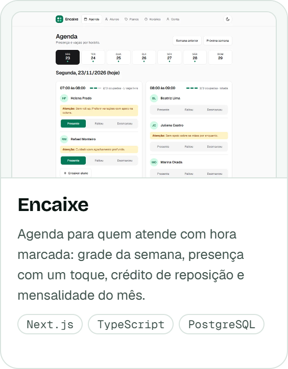</picture>
<picture><source media="(prefers-color-scheme: dark)" srcset="assets/p-pede-ai-dark.png">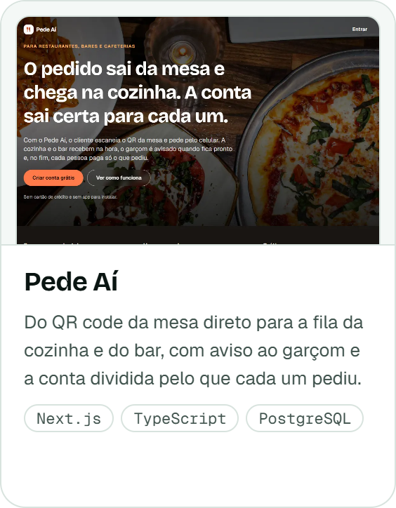</picture>
<picture><source media="(prefers-color-scheme: dark)" srcset="assets/p-entendendo-algoritmos-dark.png">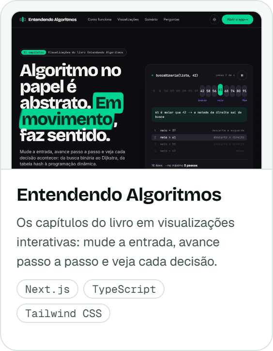</picture>

**Demos:** [Encaixe ↗](https://dn-encaixe.vercel.app) · [Pede Aí ↗](https://dn-pede-ai.vercel.app) · [Entendendo Algoritmos ↗](https://entendendo-algoritmos.vercel.app)

<a href="https://diegonatalo.dev/projetos"><b>Ver todos os 11 projetos no portfólio →</b></a>

 

<picture><source media="(prefers-color-scheme: dark)" srcset="assets/h-trajetoria-dark.png">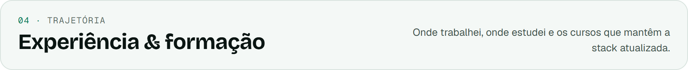</picture>

 

<picture><source media="(prefers-color-scheme: dark)" srcset="assets/trajetoria-dark.png"></picture>

 

<picture><source media="(prefers-color-scheme: dark)" srcset="assets/h-github-dark.png">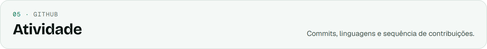</picture>

 

<picture><source media="(prefers-color-scheme: dark)" srcset="https://github-readme-stats.vercel.app/api?username=diegonatalo&show_icons=true&include_all_commits=true&locale=pt-br&bg_color=060b0e&title_color=38e8a8&text_color=e7f1ee&icon_color=5aa9ff&border_color=26353b"></picture>
<picture><source media="(prefers-color-scheme: dark)" srcset="https://streak-stats.demolab.com?user=diegonatalo&locale=pt_BR&background=060B0E&border=26353B&stroke=26353B&ring=38E8A8&fire=5AA9FF&currStreakNum=E7F1EE&currStreakLabel=38E8A8&sideNums=E7F1EE&sideLabels=9DB1AA&dates=9DB1AA"></picture>

 

<picture><source media="(prefers-color-scheme: dark)" srcset="assets/h-contato-dark.png">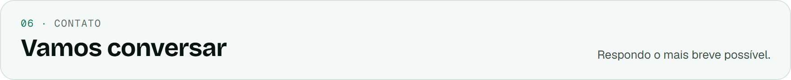</picture>

 

<picture><source media="(prefers-color-scheme: dark)" srcset="assets/contato-dark.png">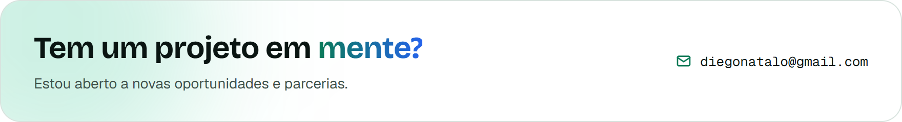</picture>

 

  

<picture><source media="(prefers-color-scheme: dark)" srcset="assets/footer-dark.png"></picture>

